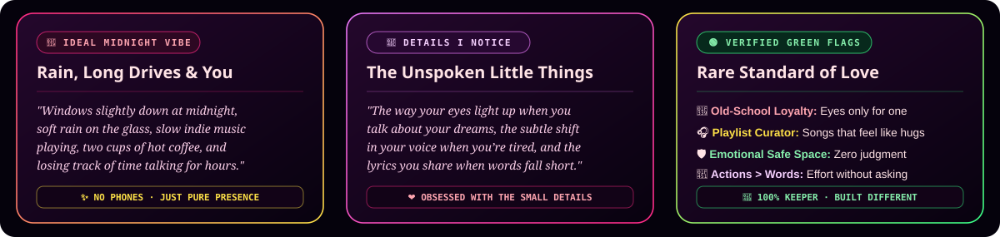
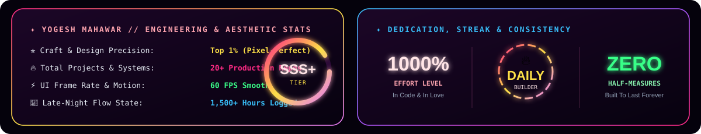

<!-- ==================== VELVET MIDNIGHT ROMANTIC HERO ==================== -->

 

<!-- ==================== POETIC ANIMATED STREAM ==================== -->

  

<!-- ==================== LUXURY AURA & VIEWS BADGES ==================== -->

<!-- ==================== THE BOOK YOU UNDERLINE // OPEN JOURNAL ==================== -->
<h2 align="center">📖 &nbsp; THE BOOK YOU UNDERLINE // MIDNIGHT PAGES &nbsp; ❤️</h2>

// open to page 143 — written in midnight ink &amp; stubborn love

  

<!-- ==================== IDEAL MIDNIGHT VIBE & GREEN FLAGS ==================== -->
<h2 align="center">🌹 &nbsp; MIDNIGHT VIBES, DETAILS I NOTICE &amp; GREEN FLAGS &nbsp; ✨</h2>

// the little things that turn ordinary nights into poetry

  

<!-- ==================== LIVE PROFILE VIEWS & AURA TELEMETRY ==================== -->
<h2 align="center">✦ &nbsp; LIVE PROFILE VIEWS &amp; AURA RADAR &nbsp; ✦</h2>

// real-time visitor pulse, first-impression score &amp; midnight frequency

  

<!-- ==================== SOUL & CODE // COMMAND CENTER ==================== -->
<h2 align="center">✦ &nbsp; SOUL_AND_CODE.TS // WHO IS YOGESH? &nbsp; ✦</h2>

// half logic, half poetry — decoded at 2:00 AM

  

 

<!-- ==================== THE DUALITY: MIND x HEART ==================== -->
<h2 align="center">✦ &nbsp; THE DUALITY // BRAIN × HEART &nbsp; ✦</h2>

// rare combination of relentless ambition and old-school romance

  

 

<table>
  <tr>
    <td width="50%" valign="top">
      <h3>🌹 How I Love &amp; Live ("stubbornlove")</h3>
      <blockquote>
        <i>"ɪ ᴡᴀɴᴛ ᴛᴏ ʙᴇ ᴛʜᴇ ᴘᴀʀᴛꜱ ᴏꜰ ᴛʜᴇ ʙᴏᴏᴋ ʏᴏᴜ ᴜɴᴅᴇʀʟɪɴᴇ ❤️"</i>
      </blockquote>
      

        In a world where everyone is rushing and everything feels temporary, I still believe in <b>old-school romance, deep loyalty, and timeless effort</b>. Whether it's a promise, a 2 AM conversation, or a dream — if it matters to me, I give it <b>1000%</b>.
      

      <ul>
        <li><b>My Love Language:</b> Remembering every tiny detail you once mentioned in passing</li>
        <li><b>Perfect Escape:</b> Late-night drives, rain on the windshield, coffee &amp; slow songs</li>
        <li><b>My Promise:</b> Protecting your peace, making you laugh &amp; never letting you doubt your worth</li>
      </ul>
    </td>
    <td width="50%" valign="top">
      <h3>⚡ The Ambition &amp; Craft</h3>
      <blockquote>
        <i>"Know your worth, darling — build an empire, but keep your heart soft."</i>
      </blockquote>
      

        By day (and late into the night), I architect luxury interfaces and AI systems that feel like the future is already here — <b>precise, fast, and unforgettable</b>.
      

      <ul>
        <li><b>Luxury Frontend UI:</b> React, Next.js, TypeScript &amp; 60fps fluid motion</li>
        <li><b>Autonomous AI &amp; Bots:</b> Python neural agents, smart media &amp; cloud pipelines</li>
        <li><b>Full-Stack Architecture:</b> Node.js, PostgreSQL, Redis, Docker &amp; AWS</li>
        <li><b>Life Rule:</b> <i>Never half-love. Never ship ugly.</i></li>
      </ul>
    </td>
  </tr>
</table>

<!-- ==================== CURRENT FREQUENCY // VINYL DECK ==================== -->
<h2 align="center">🎧 &nbsp; MIDNIGHT FREQUENCY // ON REPEAT &nbsp; 🌙</h2>

// close your eyes &amp; press play — the soundtrack of stubbornlove

  

<!-- ==================== ENGINEERING JOURNEY ==================== -->
<h2 align="center">✦ &nbsp; THE EVOLUTION // TIMELINE &nbsp; ✦</h2>

// how curiosity turned into craft

  

<!-- ==================== FEATURED WORK ==================== -->
<h2 align="center">✦ &nbsp; SIGNATURE CREATIONS &amp; ARCHITECTURE &nbsp; ✦</h2>

// flagship systems across EdTech, AI automation &amp; luxury UI

  
    
  

<!-- ==================== TECH DASHBOARD ==================== -->
<h2 align="center">✦ &nbsp; ARSENAL &amp; STACK TELEMETRY &nbsp; ✦</h2>

// tools used to turn imagination into reality

  

 

**Frontend &amp; Luxury UI**
 

  

**AI, Backend &amp; Cloud**
 

<!-- ==================== LIVE METRICS & VELOCITY ==================== -->
<h2 align="center">✦ &nbsp; CONSISTENCY &amp; VELOCITY &nbsp; ✦</h2>

// SSS+ tier metrics — because actions speak louder than words

  

    

  

<!-- ==================== CONTRIBUTION SNAKE ==================== -->
<h2 align="center">✦ &nbsp; NEURAL CONTRIBUTION MATRIX &nbsp; ✦</h2>

  

<!-- ==================== ACHIEVEMENTS & TROPHIES ==================== -->
<h2 align="center">✦ &nbsp; UNLOCKED RANKS &amp; TROPHIES &nbsp; ✦</h2>

  

<!-- ==================== MIDNIGHT NOTE & CONTACT ==================== -->

  

 

<h2 align="center">💌 &nbsp; SAY HELLO // MY INBOX IS OPEN &nbsp; ❤️</h2>

// whether it's about a midnight song, a dream project, or just a "hey" — I'd love to hear from you

&nbsp;

&nbsp;

  

 

