

<!-- ==================== VELVET MIDNIGHT HERO BANNER ==================== -->

 

<!-- ==================== POETIC + TECH TYPING STREAM ==================== -->

 

<!-- ==================== LUXURY AURA BADGES ==================== -->


<!-- ==================== SOUL & CODE // COMMAND CENTER ==================== -->
<h2 align="center">✦ &nbsp; SOUL_AND_CODE.TS // WHO IS YOGESH? &nbsp; ✦</h2>

// half logic, half poetry — decoded at 2:00 AM

  

 

<!-- ==================== THE DUALITY: MIND x HEART ==================== -->
<h2 align="center">✦ &nbsp; THE DUALITY // BRAIN × HEART &nbsp; ✦</h2>

// rare combination of relentless ambition and old-school romance

  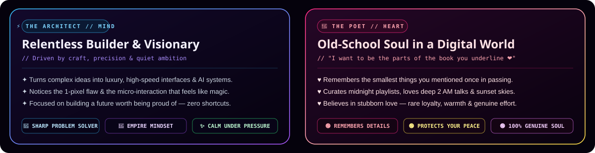

 

<table>
  <tr>
    <td width="50%" valign="top">
      <h3>🌹 Why "stubbornlove"?</h3>
      <blockquote>
        <i>"ɪ ᴡᴀɴᴛ ᴛᴏ ʙᴇ ᴛʜᴇ ᴘᴀʀᴛꜱ ᴏꜰ ᴛʜᴇ ʙᴏᴏᴋ ʏᴏᴜ ᴜɴᴅᴇʀʟɪɴᴇ ❤️"</i>
      </blockquote>
      

        Because in a world where everything feels temporary and rushed, I still believe in <b>depth, loyalty, and timeless craft</b>. Whether it's a line of code, a late-night conversation, or a promise — if I care about it, I give it <b>1000%</b>.
      

      <ul>
        <li><b>The Vibe:</b> Sunset drives, rainy window lofi &amp; effortless warmth</li>
        <li><b>The Detail:</b> Notices the little things everyone else walks past</li>
        <li><b>The Standard:</b> Protects your peace &amp; matches words with actions</li>
      </ul>
    </td>
    <td width="50%" valign="top">
      <h3>⚡ The Craft &amp; Ambition</h3>
      

        By day (and late into the night), I architect interfaces and AI systems that feel like the future is already here — <b>precise, fast, and quietly luxurious</b>.
      

      <ul>
        <li><b>Luxury Frontend UI:</b> React, Next.js, TypeScript &amp; 60fps motion systems</li>
        <li><b>Autonomous AI &amp; Bots:</b> Python neural agents, smart media &amp; cloud pipelines</li>
        <li><b>Full-Stack Architecture:</b> Node.js, PostgreSQL, Redis, Docker &amp; AWS</li>
        <li><b>Motto:</b> <i>Ship fast, never ship ugly. Never half-love.</i></li>
      </ul>
    </td>
  </tr>
</table>

<!-- ==================== CURRENT FREQUENCY // VINYL DECK ==================== -->
<h2 align="center">✦ &nbsp; MIDNIGHT FREQUENCY // ON REPEAT &nbsp; ✦</h2>

// press play — the soundtrack behind the commits

  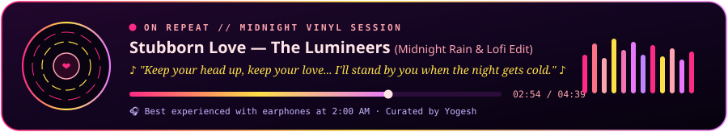

<!-- ==================== ENGINEERING JOURNEY ==================== -->
<h2 align="center">✦ &nbsp; THE EVOLUTION // TIMELINE &nbsp; ✦</h2>

// how curiosity turned into craft

  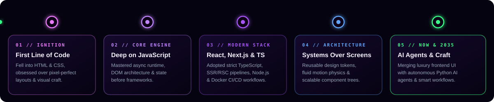

<!-- ==================== FEATURED WORK ==================== -->
<h2 align="center">✦ &nbsp; SIGNATURE CREATIONS &amp; ARCHITECTURE &nbsp; ✦</h2>

// flagship systems across EdTech, AI automation &amp; luxury UI

  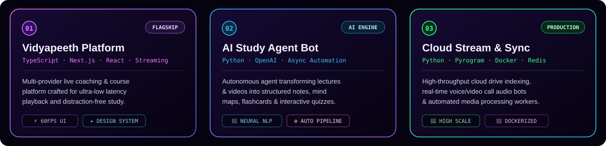
    
  

<!-- ==================== TECH DASHBOARD ==================== -->
<h2 align="center">✦ &nbsp; ARSENAL &amp; STACK TELEMETRY &nbsp; ✦</h2>

// tools used to turn imagination into reality

  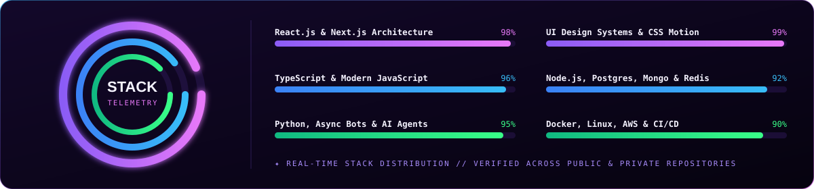

 

**Frontend &amp; Luxury UI**
 

  

**AI, Backend &amp; Cloud**
 

<!-- ==================== LIVE METRICS & VELOCITY ==================== -->
<h2 align="center">✦ &nbsp; CONSISTENCY &amp; VELOCITY &nbsp; ✦</h2>

// real-time stats — because actions speak louder than words

  
  

    

  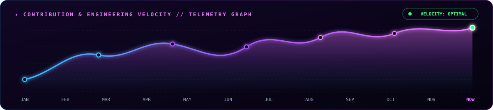

<!-- ==================== CONTRIBUTION SNAKE ==================== -->
<h2 align="center">✦ &nbsp; NEURAL CONTRIBUTION MATRIX &nbsp; ✦</h2>

  

<!-- ==================== ACHIEVEMENTS & TROPHIES ==================== -->
<h2 align="center">✦ &nbsp; UNLOCKED RANKS &amp; TROPHIES &nbsp; ✦</h2>

  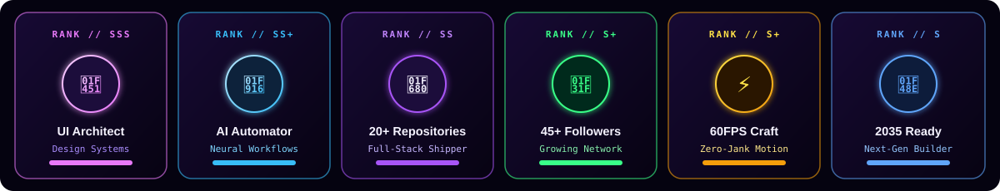

<!-- ==================== MIDNIGHT NOTE & CONTACT ==================== -->

  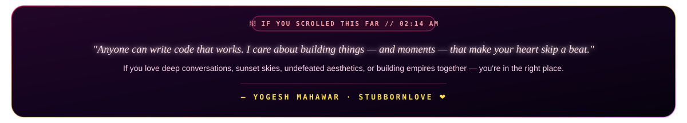

 

<h2 align="center">✦ &nbsp; SAY HELLO // MY INBOX IS OPEN &nbsp; ✦</h2>

// whether it's about a project, a midnight song recommendation, or just saying hi ❤️

&nbsp;

&nbsp;

  

 

