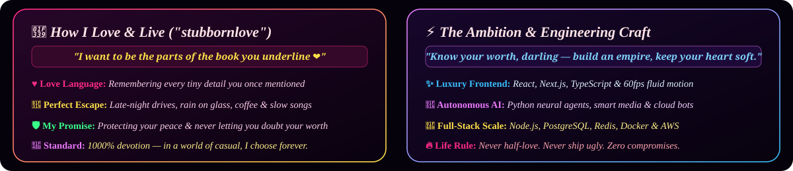

<!-- ==================== VELVET MIDNIGHT ROMANTIC HERO ==================== -->

 

<!-- ==================== POETIC ANIMATED STREAM ==================== -->

  

<!-- ==================== LUXURY AURA & VIEWS BADGES ==================== -->

<!-- ==================== THE BOOK YOU UNDERLINE // OPEN JOURNAL ==================== -->

<!-- ==================== IDEAL MIDNIGHT VIBE & GREEN FLAGS ==================== -->

<!-- ==================== LIVE PROFILE VIEWS & AURA TELEMETRY ==================== -->

<!-- ==================== SOUL & CODE // COMMAND CENTER ==================== -->

 

<!-- ==================== THE DUALITY: MIND x HEART ==================== -->

 

<!-- ==================== CURRENT FREQUENCY // VINYL DECK ==================== -->

<!-- ==================== ENGINEERING JOURNEY ==================== -->

<!-- ==================== FEATURED WORK ==================== -->

  

<!-- ==================== TECH DASHBOARD ==================== -->

  

 

  

 

<!-- ==================== LIVE METRICS & VELOCITY ==================== -->

  

<!-- ==================== CONTRIBUTION SNAKE ==================== -->

<!-- ==================== ACHIEVEMENTS & TROPHIES ==================== -->

<!-- ==================== MIDNIGHT NOTE & CONTACT ==================== -->

 

&nbsp;

&nbsp;

  

  

