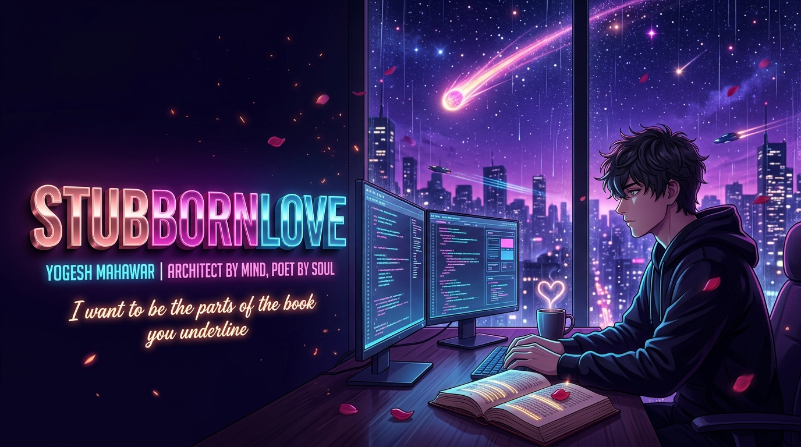
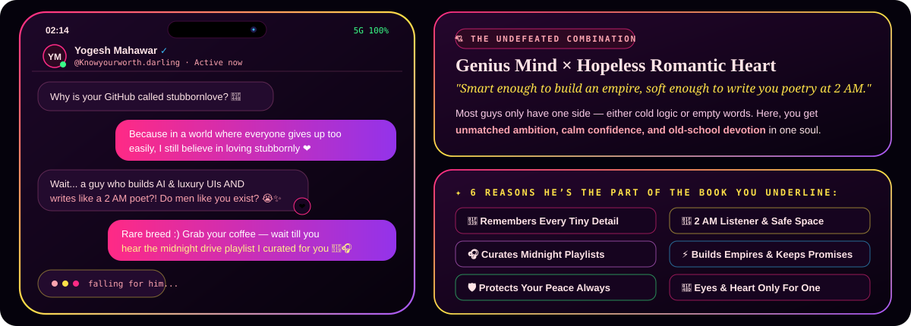
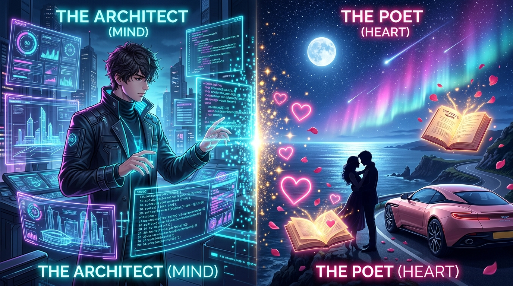
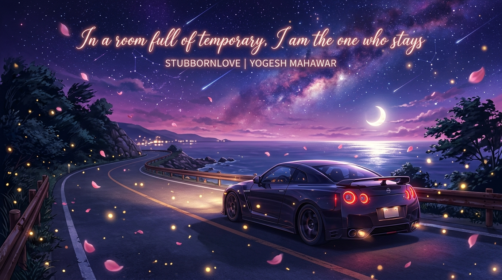

<!-- ==================== ACT I: 8K MAKOTO SHINKAI x LUXURY ROMANTIC HERO ==================== -->

  

<!-- ==================== POETIC ANIMATED STREAM ==================== -->

  

<!-- ==================== LUXURY AURA & VIEWS BADGES ==================== -->

<!-- ==================== ACT II: 02:14 AM IPHONE DM & GREEN FLAGS ==================== -->
<h2 align="center">📱 &nbsp; 02:14 AM // LATE-NIGHT CONVERSATION &amp; VIBE CHECK &nbsp; ❤️</h2>

// when a hopeless romantic also happens to be a 10x architect

  

<!-- ==================== ACT III: THE BOOK YOU UNDERLINE (OPEN JOURNAL) ==================== -->
<h2 align="center">📖 &nbsp; THE BOOK YOU UNDERLINE // MIDNIGHT PAGES (P. 143–144) &nbsp; ✨</h2>

// written in midnight ink — fold the corner of this page and come back whenever the world gets loud

  
    
  

<!-- ==================== ACT IV: THE DUALITY (8K SPLIT WORLD + BENTO) ==================== -->
<h2 align="center">🌌 &nbsp; TWO WORLDS IN ONE SOUL // THE ARCHITECT × THE POET &nbsp; 🌹</h2>

// left brain builds futuristic empires · right heart writes midnight poetry

  
    
  

 

<table>
  <tr>
    <td width="50%" valign="top">
      <h3>🌹 The Romantic Soul ("stubbornlove")</h3>
      <blockquote>
        <i>"ɪ ᴡᴀɴᴛ ᴛᴏ ʙᴇ ᴛʜᴇ ᴘᴀʀᴛꜱ ᴏꜰ ᴛʜᴇ ʙᴏᴏᴋ ʏᴏᴜ ᴜɴᴅᴇʀʟɪɴᴇ ❤️"</i>
      </blockquote>
      

        In a generation where everything feels rushed and temporary, I still believe in <b>old-school romance, deep loyalty, and timeless effort</b>. Whether it's a promise, a 2 AM conversation, or a dream — if it matters to me, I give it <b>1000%</b>.
      

      <ul>
        <li><b>Love Language:</b> Remembering every tiny detail you once mentioned in passing</li>
        <li><b>Perfect Escape:</b> Late-night drives, rain on the windshield, coffee &amp; slow songs</li>
        <li><b>Standard:</b> Protecting your peace, making you laugh &amp; never letting you doubt your worth</li>
      </ul>
    </td>
    <td width="50%" valign="top">
      <h3>⚡ The Visionary Architect</h3>
      <blockquote>
        <i>"Know your worth, darling — build an empire, but keep your heart soft."</i>
      </blockquote>
      

        By day (and late into the night), I architect luxury interfaces and AI systems that feel like the future is already here — <b>precise, fast, and unforgettable</b>.
      

      <ul>
        <li><b>Luxury Frontend UI:</b> React, Next.js, TypeScript &amp; 60fps fluid motion</li>
        <li><b>Autonomous AI &amp; Bots:</b> Python neural agents, smart media &amp; cloud pipelines</li>
        <li><b>Full-Stack Architecture:</b> Node.js, PostgreSQL, Redis, Docker &amp; AWS</li>
        <li><b>Life Rule:</b> <i>Never half-love. Never ship ugly.</i></li>
      </ul>
    </td>
  </tr>
</table>

<!-- ==================== ACT V: MIDNIGHT RAIN & VINYL SESSION ==================== -->
<h2 align="center">🎧 &nbsp; 02:00 AM RAIN &amp; VINYL SESSION // ON REPEAT &nbsp; 🌙</h2>

// rain on the window, warm coffee, and the song that inspired the name

  
    
  

<!-- ==================== ACT VI: LIVE PROFILE VIEWS & SOUL_AND_CODE.TS ==================== -->
<h2 align="center">✦ &nbsp; LIVE PROFILE VIEWS, AURA RADAR &amp; TERMINAL &nbsp; ✦</h2>

// real-time visitor pulse, crush probability &amp; ~/yogesh/soul_and_code.ts

  
    
  

<!-- ==================== ACT VII: SIGNATURE CREATIONS, STACK & METRICS ==================== -->
<h2 align="center">✦ &nbsp; SIGNATURE CREATIONS &amp; TECH ARSENAL &nbsp; ✦</h2>

// flagship systems across EdTech, AI automation &amp; luxury UI

  
    
  
    
  

 

  

<!-- ==================== CONSISTENCY, SNAKE & TROPHIES ==================== -->
<h2 align="center">✦ &nbsp; SSS+ CONSISTENCY, VELOCITY &amp; TROPHIES &nbsp; ✦</h2>

  
    
  
    
  
    
  

<!-- ==================== ACT VIII: MIDNIGHT LETTER, CONTACT & COASTAL DRIVE FINALE ==================== -->

  

 

<h2 align="center">💌 &nbsp; DON&#8217;T BE A STRANGER // SAY HELLO &nbsp; ❤️</h2>

// whether it's a midnight song recommendation, a dream collab, or just a "hey" — my inbox is waiting for you

&nbsp;

&nbsp;

  

 

